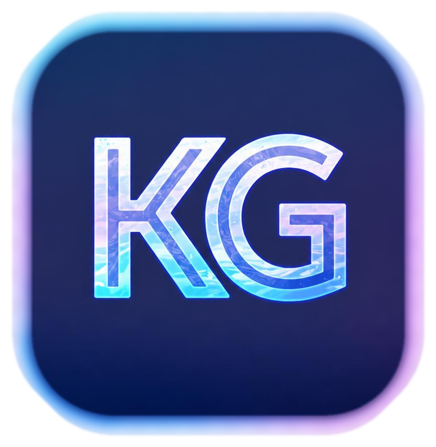

# K GAME TRACKER (KG Tracker)

<p align="center">
  
</p>

<p align="center"><strong>Encuentra y reclama juegos gratis para PC por tiempo limitado desde una sola app de Windows.</strong></p>

<p align="center">
  <a href="#características-principales">Características</a> · <a href="#inicio-rápido">Inicio rápido</a> · <a href="#créditos-y-fuentes-de-datos">Créditos</a> · <a href="https://github.com/Kgamesdev/KG-TRACKER/issues">Ideas y fallos</a>
</p>

<p align="center"><a href="README.md"><strong>🇬🇧 Read in English</strong></a></p>

<p align="center">
  
  
  
  
  <a href="LICENSE"></a>
</p>

<p align="center">
  <a href="https://github.com/Kgamesdev/KG-TRACKER/stargazers"></a>
  <a href="https://github.com/Kgamesdev/KG-TRACKER/issues"></a>
</p>

---

## 🎮 Descripción del Proyecto

**KG Tracker** es una aplicación de escritorio nativa para Windows, desarrollada en **Python** y **PySide6 (Qt 6)**. Te ayuda a encontrar ofertas de juegos para PC gratis y por tiempo limitado en distintas tiendas, desde un solo lugar. También añade reseñas de Steam cuando están disponibles y traduce las descripciones en segundo plano.

## ✨ Características Principales

- **Búsqueda amplia de juegos gratis:** combina GamerPower con búsquedas directas en Epic Games, Steam, GOG, itch.io, Amazon Prime Gaming y Fanatical. También pueden aparecer otras tiendas mediante GamerPower; la cobertura directa depende de los datos públicos de cada tienda.
- **Búsquedas automáticas:** busca al iniciar la app y puede repetir la búsqueda con el intervalo elegido en Ajustes. Los resultados aparecen en la app; las páginas de las tiendas solo se abren cuando eliges una oferta.
- **Filtrado y deduplicación inteligente:** filtra demos y complementos, y unifica ofertas duplicadas entre fuentes, enlaces regionales y títulos traducidos.
- **Información útil del juego:** muestra reseñas de Steam cuando están disponibles y traduce descripciones en segundo plano.
- **Avisos y búsquedas en segundo plano:** permite buscar cuando quieras o de forma periódica, con notificaciones de Windows desde la bandeja del sistema al minimizar la app.
- **Historial de reclamados y ahorro:** guarda localmente los juegos reclamados y calcula su valor acumulado.
- **Ajustes personales:** interfaz en español e inglés, temas claro y oscuro suavizados, preferencia de música guardada, controles de silencio y volumen, intervalo de búsqueda, notificaciones e inicio opcional con Windows.
- **Comportamiento de ventana:** protección contra varias instancias, minimización a la bandeja y una opción para minimizar o salir al cerrar la ventana.
- **Interfaz ágil:** carga las imágenes en segundo plano y utiliza caché para que la navegación sea fluida.

## 🚀 Inicio Rápido

**Requisitos:** Windows 10 u 11 y Python 3.12.

**App lista para usar:** descarga la versión de Windows desde la [versión 0.4.0](https://github.com/Kgamesdev/KG-TRACKER/releases/tag/v0.4.0).

### Aviso de Windows y comprobación SHA-256

Windows SmartScreen puede mostrar una advertencia al descargar o iniciar KG Tracker porque el ejecutable no está firmado con un certificado de firma de código de confianza pública. Es una advertencia de reputación del editor/archivo; por sí sola no demuestra que el programa sea malicioso ni garantiza que sea seguro.

Descarga el EXE únicamente desde la [versión oficial en GitHub](https://github.com/Kgamesdev/KG-TRACKER/releases/tag/v0.4.0). Cada versión incluye un archivo `.sha256` para comparar la huella del ejecutable. En PowerShell puedes obtenerla con `Get-FileHash .\KG-TRACKER.exe -Algorithm SHA256` y comparar el valor con el publicado.

SHA-256 solo permite comprobar que el archivo coincide byte por byte con el archivo al que corresponde la huella. No certifica quién lo creó, que esté libre de malware ni elimina la advertencia de SmartScreen.

```powershell
git clone https://github.com/Kgamesdev/KG-TRACKER.git
cd KG-TRACKER
py -3.12 -m venv .venv
.\.venv\Scripts\python.exe -m pip install -r requirements.txt
.\.venv\Scripts\python.exe main.py
```

## 👋 Sobre el Autor

> Este proyecto personal lo he creado yo, un enfermero que nunca ha tenido demasiado tiempo para estudiar programación, pero que siempre ha tenido unas ganas enormes de aprender. Lo he desarrollado a partir de investigación y con ayuda de la IA. Espero que disfrutéis las horas y el cariño que le he dedicado.

## 🧰 Arquitectura y Stack Tecnológico

| Componente | Tecnología |
| :--- | :--- |
| **Lenguaje** | Python 3.12 (probado) |
| **Interfaz Gráfica** | PySide6 (Qt 6.x) con hojas de estilo QSS |
| **Conexiones de red** | `requests` y sesiones concurrentes |
| **Motor de Audio** | `pygame-ce` |
| **Persistencia** | JSON local con escrituras atómicas |

## 🔌 Créditos y Fuentes de Datos

KG Tracker utiliza los siguientes servicios, endpoints públicos y páginas de las tiendas. Algunas fuentes son páginas web públicas, no APIs formales. La disponibilidad y los datos de las ofertas dependen de sus proveedores.

- **[API de GamerPower](https://www.gamerpower.com/api/)** — listados y detalles de regalos.
- **[Epic Games Store](https://store-site-backend-static.ak.epicgames.com/)** — catálogo de promociones de juegos gratis.
- **[Steam Store](https://store.steampowered.com/)** — juegos destacados gratis o rebajados, búsqueda de juegos y reseñas de la comunidad; las imágenes se sirven desde la CDN de Steam.
- **[itch.io](https://itch.io/games/on-sale?format=json)** — listado de juegos en oferta.
- **[Catálogo de GOG](https://catalog.gog.com/)** — catálogo de juegos rebajados.
- **[Amazon Games / Luna](https://www.amazongamestudios.com/en-us/news)** — anuncios de ofertas de Prime Gaming y páginas públicas para reclamarlas.
- **[Promociones de Fanatical](https://support.fanatical.com/hc/en-us/articles/360018002197-Promotions-Summary-Terms-and-Conditions)** — información de promociones para identificar regalos vigentes.
- **[Google Translate](https://translate.googleapis.com/)** — fuente principal para traducir descripciones.
- **[API de traducción MyMemory](https://mymemory.translated.net/)** — alternativa de traducción.
- **[API de GitHub Releases](https://docs.github.com/en/rest/releases/releases)** — consulta de nuevas versiones desde la app.

## ☕ Apoya el Proyecto

Si KG Tracker te resulta útil y quieres apoyar su desarrollo, puedes [invitarme a un café en Ko-fi](https://ko-fi.com/kurigamedeveloper).

## 📋 Novedades Recientes (v0.4.0)

- Nuevas búsquedas directas de juegos gratis en Amazon Prime Gaming y Fanatical, además de las tiendas existentes y el respaldo de GamerPower.
- Mejor detección de duplicados entre idiomas, fuentes y enlaces regionales de una misma oferta.
- Búsqueda automática al iniciar, ajustes de audio persistentes y comportamiento más claro al minimizar a la bandeja o salir.
- Tema claro actualizado y pestañas de tiendas cerradas hasta que el usuario abra una oferta.
- Carga de imágenes más resistente a fallos temporales y uso de imágenes alternativas cuando están disponibles.
- Reorganización interna de componentes visuales para facilitar el mantenimiento, manteniendo el comportamiento de la interfaz.

## 🤝 Ayuda a Mejorar el Proyecto

¿Has encontrado un fallo o tienes una idea? [Abre una incidencia](https://github.com/Kgamesdev/KG-TRACKER/issues). Las contribuciones son bienvenidas; consulta la [licencia no comercial](LICENSE) antes de reutilizar el código.

## Licencia

Este proyecto está bajo una **Licencia No Comercial**. Consulta [LICENSE](LICENSE) para más información.
